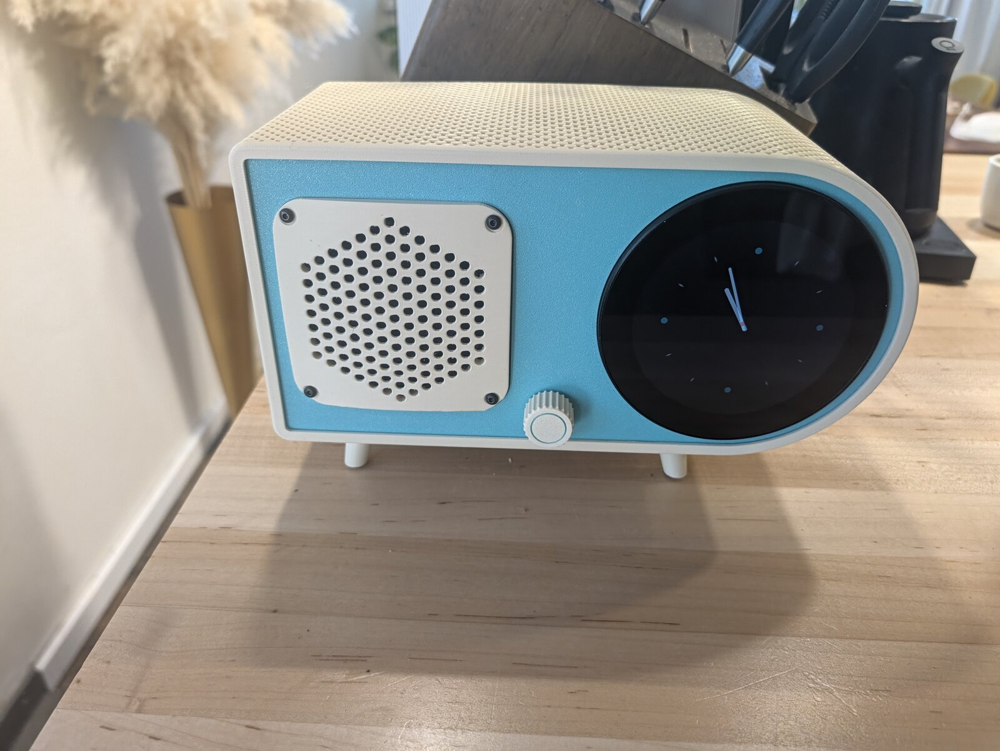
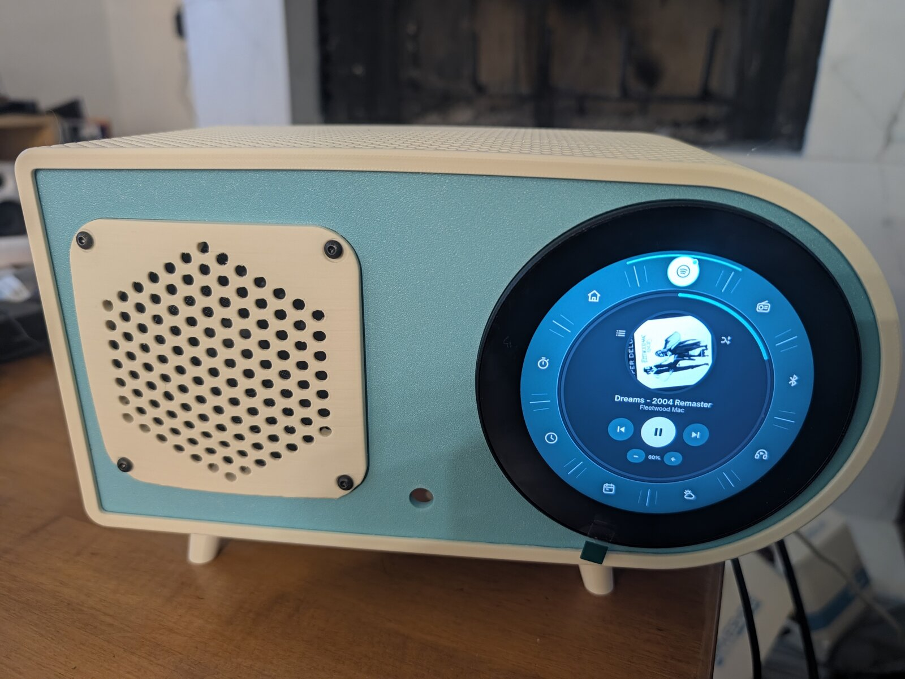
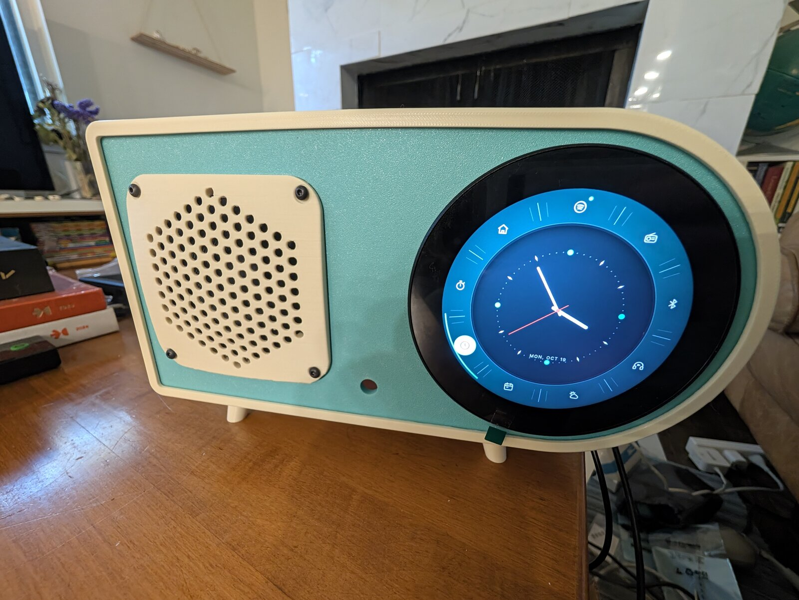
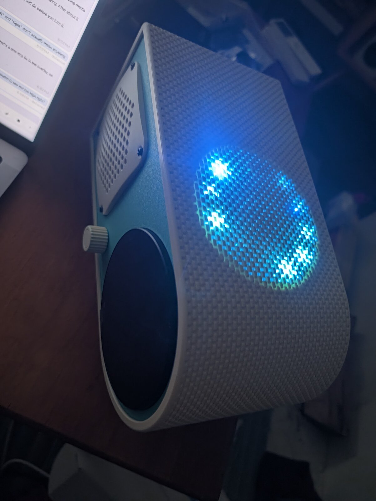
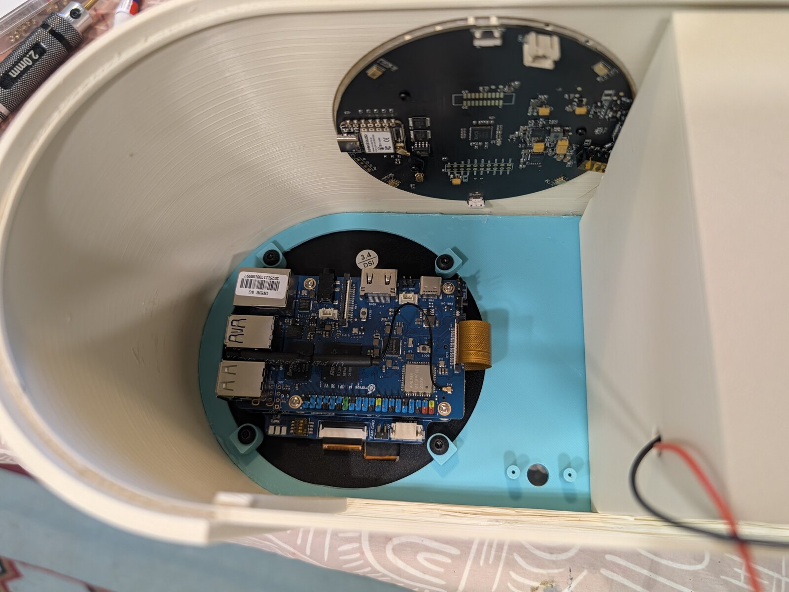
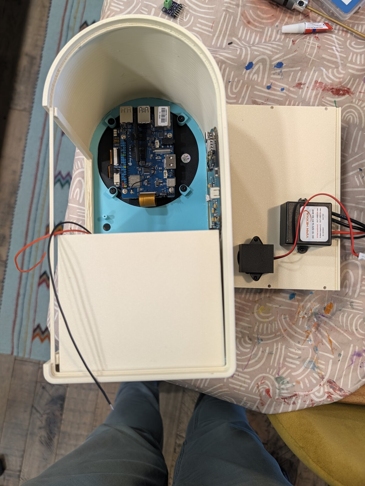
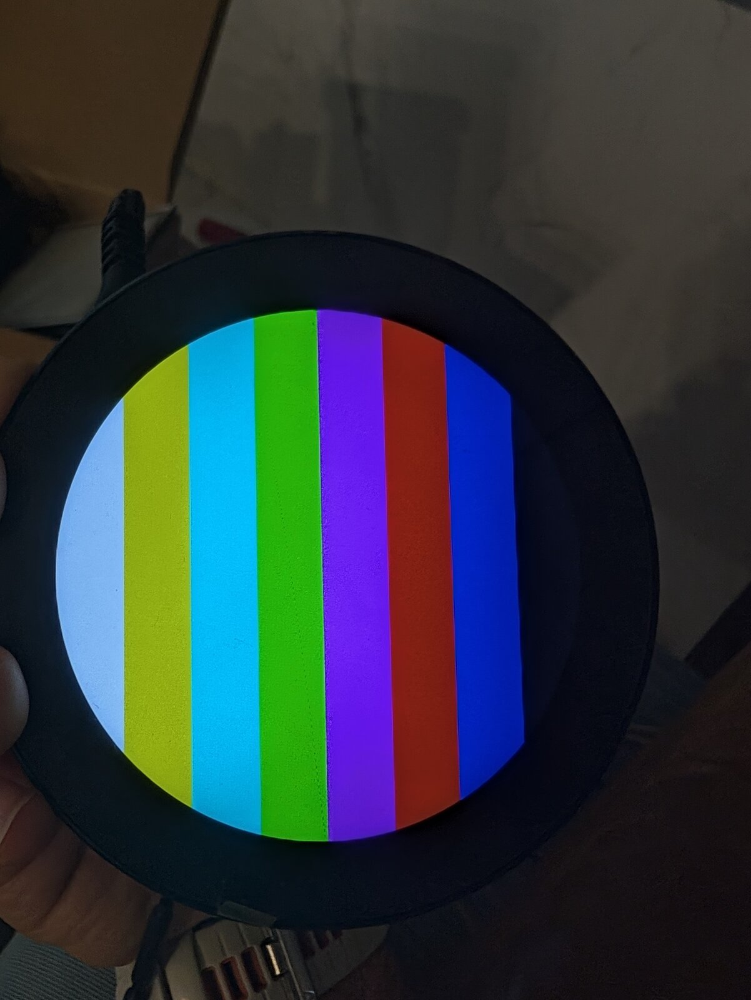
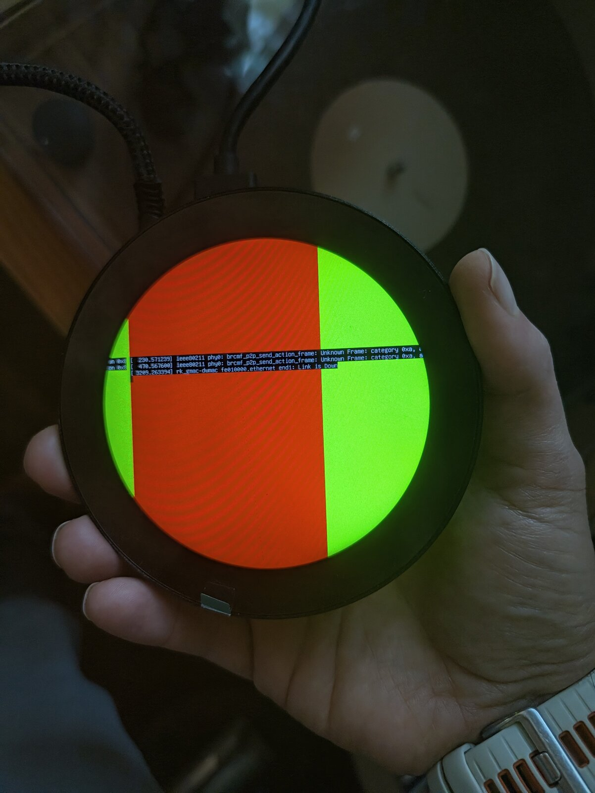

# Zephyr Smart Radio



A bullet-radio kitchen speaker and voice satellite: a 40s Fada-style case in ivory and
turquoise, a round 800x800 touch screen, a knob, and a Dayton PC83 music speaker. You talk to it
and Claude answers; it plays Spotify, internet radio, audiobooks (from an
[Audiobookshelf](https://www.audiobookshelf.org/) server) and phone audio.

This is one person's build, published as is: addresses and hostnames in the scripts are the
author's defaults (override them with arguments or `/etc/satd.json`), and the Claude side runs
through the author's own session hub. Expect to adapt it, not to install it.

Two computers live inside:

| Half | Hardware | Software here |
|---|---|---|
| **Radio** (screen, music, knob) | Orange Pi 3B (eMMC), Waveshare 3.4" round DSI, GT9271 touch, EC11 knob, MAX98357A amp on I2S1 -> PC83 | `satd/`, `ui/`, `touch/`, `system/`, `dt/` |
| **Voice** (mics, wake word, replies) | reSpeaker XVF3800 (4 mics, XMOS DSP with echo cancellation) + XIAO ESP32-S3 on ESPHome, own small speaker | `esphome/` |

Power: one USB-C cable from a PD wall charger into a 15 V trigger board inside, feeding a dual USB-C buck: one 5 V port to the Pi, one to the XIAO. Only plug the
XIAO's USB-C into the reSpeaker; plugging both knocks the reSpeaker out of USB mode.

## How a question flows

wake word (on the XIAO) -> Home Assistant pipeline "Satellite (Claude)" -> Whisper (Wyoming) ->
`conversation.satellite_claude` (a custom conversation agent, not in this repo) -> one
persistent Claude Code session running in `agent/` -> Piper TTS -> the reSpeaker's speaker.
While the satellite listens or talks, satd ducks the music. While Zephyr plays anything, satd
switches the wake word off (HA `select.satellite_voice_wake_word` = `no_wake_word`), because
the reSpeaker only cancels the echo of its own speaker, not Zephyr's. The knob still talks.

## Layout

| Path | What |
|---|---|
| `satd/` | aiohttp service on the Pi (:8080): UI backend, Spotify/radio/audiobooks/Bluetooth, timers, volume and ducking, wake word control, HA remote API. `books.py` plays audiobooks from Audiobookshelf in its own mpv and syncs progress to the server (`abs_url`, `abs_token` in `/etc/satd.json`); `audible.py` is the retired Audible web-player driver, kept for reference. |
| `ui/` | Kiosk page (cage + Chromium): ring of apps, Spotify Web Playback SDK device "Zephyr", audiobook library (`books.js`). |
| `touch/` | GT9271 poller -> uinput (the ribbon has no INT line). |
| `system/` | systemd units, udev rules, `asound.conf` (EQ -> softvol -> dmix -> amp). |
| `dt/` | Device-tree overlays: DSI panel, MAX98357A on I2S1, EC11 knob. `attic/`, `debug/` = bring-up history. |
| `esphome/` | `satellite-voice.yaml` for the XIAO (formatBCE XVF3800 integration, pinned). `secrets.yaml` is local only. |
| `ha/` | `satellite_speaker` custom component: Zephyr as `media_player.zephyr` in HA. |
| `agent/` | Workspace of the Claude Code session: copy `CLAUDE.example.md` -> `CLAUDE.md` (spoken rules, your house) and `.mcp.example.json` -> `.mcp.json` (Home Assistant MCP, your token). Both stay out of git. Restart the session after editing either. |
| `tools/` | `shots.sh` (screenshot every view), `spotify-login.py`, `esp-entities.py`, `ha-api.py` (runs on the Pi), `cdp.py`. |
| `cad/` | `satellite.py` (build123d): the whole case. See `cad/README.md` for output and the vendor models it was measured from. |
| `wakeword/` | The trained "Hey Zephyr" microWakeWord model (cutoff 0.96, window 5), referenced locally by `esphome/satellite-voice.yaml`. Trained with [microWakeWord-Trainer-AppleSilicon](https://github.com/TaterTotterson/microWakeWord-Trainer-AppleSilicon). |

## Commands

```sh
sh deploy.sh                    # push satd/ui/touch/system to the Pi (root@192.168.86.62) and restart
sh tools/shots.sh <dir>         # screenshots of every view
~/.venvs/esphome/bin/esphome run esphome/satellite-voice.yaml   # build + OTA the voice half
python cad/satellite.py          # rebuild the case: any python with build123d (see the file header)
```

Voice half: ESPHome device `satellite-voice`, in HA as "Satellite Voice"; it needs an
`esphome/secrets.yaml` with `wifi_ssid`, `wifi_password`, `api_key` and `ota_password`.

## Gotchas

- To change satd alone, copy `satd/*.py` and `systemctl restart satd`; `deploy.sh` also restarts the kiosk.
- The ring app, voice and HA still call audiobooks "Audible"; they are Audiobookshelf now.
- go-librespot is dead for this account (Spotify refuses its audio keys); installed but disabled.
- Spotify needs Widevine (ChromeOS CDM via widevine_fixup.py) at /usr/lib/chromium/WidevineCdm.

## Photos

| | |
|---|---|
|  |  |
| Spotify on the round screen, with the ring of apps around it. | The clock, the home screen's default. |
|  |  |
| The mic array's LEDs glow through the open weave in the top (test print). | Inside: the Pi bolted to the screen, the reSpeaker above it. |
|  |  |
| Assembly: the front panel going into the wrap. | Bring-up: colour bars on the DSI screen. |
|  | |
| First light: the panel's first frame from the Orange Pi. | |

## Parts and license

Everything to buy and print is in [BOM.md](BOM.md). MIT licensed; see [LICENSE](LICENSE).
